<h2 align="center">Artix-7 FPGA Tabanlı 32-Bit RISC-V CPU Tasarımı, Simülasyonu ve RTL Doğrulaması</h2>

<h3 align="left">1. Giriş</h3>

<p align="justify">RTL (Register-Transfer Level) seviyesinde tasarım yapabilmek için Basys3 Geliştirme Kartında bulunan Artix-7 FPGA kullanılmıştır. RISC-V CPU'nun tasarımı VHDL ile Vivado üzerinden yapılmıştır. Tüm tasarım RTL seviyesinde çalışmaktadır. Simülasyonlar için de aynı şekilde Vivado kullanılmıştır. Tasarlanan CPU'nun veri yolu 32 bit olup ikili koda dönüştürülmüş RISC-V assembly kodlarını çalıştırabilmektedir.</p>

<h3 align="left">2. Bilgisayar Mimarisi</h3>

<p align="justify">Tasarlanan CPU toplamda 8 farklı parçadan (component) oluşmaktadır: Program Counter (PC), Instruction Memory, Instruction Register, Instruction Decoder, Register File, Data Memory, Arithmetic Logic Unit (ALU) ve Control Unit.</p>

<p align="justify">Von Neuman Mimarisinin komut ve verileri aynı bellek alanına saklaması yüzünden sebep olabileceği olası darboğaz sebebiyle Harvard Mimarisi tercih edilmiştir. Bu yüzden binary koda dönüştürülmüş RISC-V komutları, Instruction Memory'de bulunurken ALU tarafınfan üretilen çıktılar Data Memory'de bulunmaktadır.</p>

<p align="justify">CPU tasarımı için Single-Cycle, Multi-Cycle ve Pipeline tasarım yöntemlerinden Multi-Cycle tasarım tercih edilmiştir. Single-Cycle tasarımın tercih edilmemesinin temel sebebi her bir komutun tek bir clock'da çalışmak zorunda olması bu sebeple de toplama gibi kısa süren işlemlerin ile Data Memory'e veri yükleme gibi uzun bir işlem süresine eşitlenmek zorunda olmasıdır. Pipeline tasarımının tercih edilmemesindeki temel sebep ise Control Unit'in şuanlık fazla karmaşık olacağı ve aynı anda birdenf azla komutun icrasında olası race condition probelmerlinin yaşanabileceğidir. Multi-Cycle tasarım ile Control Unit, FSM (Finite-State Machine) kullanılarak istenilen karmaşıklıkta tasarlanmıştır. Bu sayede Single-Cycle'a göre Control Unit daha karmaşık hale gelmiş olurken Pipeline tasraıma göre daha az karmaşık hale gelmiştir.</p>

<p align="justify">Hem Instruction Memeory hem de Data Memory, sözcük adresleme (word addressable) olarak tasarlanmıştır. Bayt adresleme ile tasarlanmadığı için bellekteki baytların diziliminin Little-Endian veya Big-Endian mı olacağı ile ilgili bir problem ile karşılaşılmamıştır. Ek olarak, CPU için 3 farklı bus tasarlanmıştır: Data Bus, Address Bus ve Control Bus.</p>

<p align="justify">Instruction Decoder toplamda 17 farklı RISC-V komutunu decode edebilmekte olup ALU da decode edilen veriler üzerine 17 farklı işlem yapabilmektedir. Toplamda 5 farklı Buyruk (R, I, S, B, J) türüne sahip komutlar decode edilebilemkte olup RISC-V'ın I ve M uzantılarını desteklemektedir. Hangi komutların decode edildiği ve hangi buyruk türüne sahip olduğu Tablo 1'de gösterilmiştir.</p>

<div align="center">
    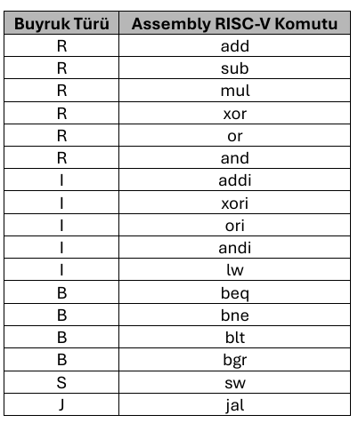
    <p><em>Tablo 1. Çalıştırılabilir RISC-V Komutları ve Buyruk Türleri</em></p>
</div>

<p align="justify">Control Unit üzerinde tasarlanan FSM; Fetch, Decode, Execute ve Write Back işlemleri için gereken kontrol sinyallerini üretlebilmektedir. Ürettiği bu kontrol sinyallerini de Control Bus üzerinden diğer parçalara (component) gönderebilmektedir.</p>

<p align="justify">Sentezleme, Place ve Route işlemlerinden sonra oluşan Bitsream dosyası FPGA içerisine yüklendiği ve RTL tasarımın doğrudan FPGA'ye entegre ediliği herhangi bir silikona entegre edilmediği için hard-core değil soft-core CPU tasarımı yapılmıştır.</p>

<h3 align="left">3. Komut Döngüsü (Instruction Cycle)</h3>

<p align="justify">Basys3 Geliştirme Kartında bulunan dahili 100MHz'lik osilatör ile kare dalga şeklindeki clock sinyali üretilir. Üretilen bu clock sinyali, Clock Wizard IP Core (MMCM) sayeinde 50MHz'e düşürülür. Clock sinyali CPU'nun içeriindeki tüm parçalara ulaşır ancak o parçada herhngi bir işelmin yapılabilmesi gerekli kontrol sinyallerinin aktif (lojik = 1) seviyesinde olması gerekmetedir. Control Unit'den hangi CPU parçasının çalışacağını gösteren kontrol sinyalleri (request) üretilir ve o anda çalışan CPU parçasının işi bitince component tarafından üretilen onay sinyali (acknowledge) ile FSM içerindeki diğer duruma geçiş yapılır. Figure 1'de Control Unit'in lojik tasarımı gösterilmiştir.</p>

<div align="center">
    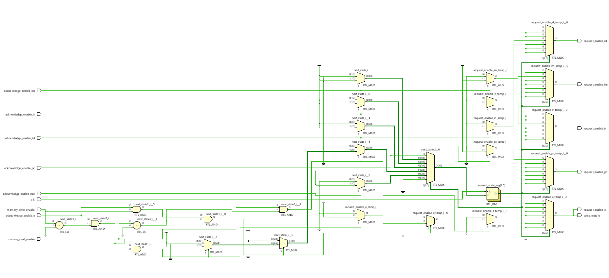
    <p><em>Figure 1. Control Unit'e Ait Lojik Devre Tasarımı</em></p>
</div>

<p align="justify">Program Counter tamamem senkron çalışmaktadır bir diğer deyişle Program Counter içeriindeki D Flip-Flop'ların tetiklenmesi için sadece Clock sinyalinin yükselen kenarı kullanılmakta olup herhangi bir asenkron sinyal kullanılmamaktadır. Control Unit'den çıkan request sinyali Program Counter (PC)'a ulaşır. Eğer herhangi bir dallanma emri yok ise PC'deki mevcut değere +4 eklenir ve bir sonraki komuta geçilir. Program Counter kendi üzerine düşen işi yaptıktan sonra Control Unit'e acknowledge sinyali gönderir ve FSM içerisindeki bir sonraki duruma geçiş yapılır. Figure 2'de Control Unit'in lojik tasarımı gösterilmiştir.</p>

<div align="center">
    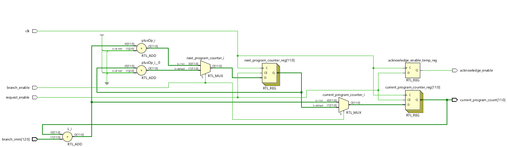
    <p><em>Figure 2. Program Counter'a Ait Lojik Devre Tasarımı</em></p>
</div>

<p align="justify">Program Counter'dan çıkan ve hangi komutun Instruction Memory'den çekileceğini gösteren sinyal, Instruction Memory'e gelir. Instruction Memory için IP Catalog'da bulunan Block Memory Generator Ip Core'u kullanılmıştır. Senkron ve Single-Port çalışması tercih edilmiştir. Instruction Memory'e herhangi bir yazma işlemi yapılamamakta olup sadece okuma işlemi yapılabilemektedir. Instruction Memory kendi üzerine düşen işi yaptıktan sonra Control Unit'e acknowledge sinyali gönderir ve FSM içerisindeki bir sonraki duruma geçiş yapılır. Figure 3'de Instruction Memory'e ait IP Core gösterilmiştir.</p>

<div align="center">
    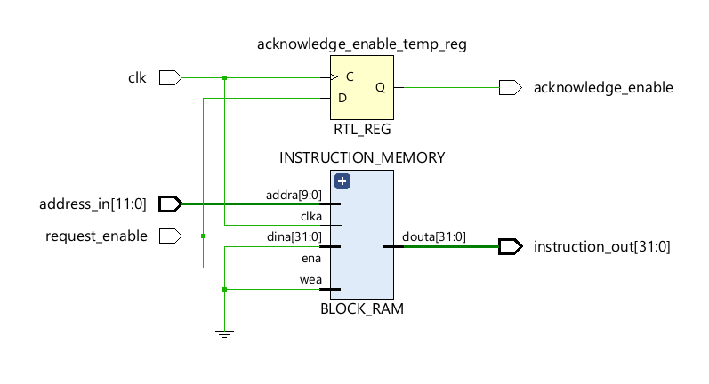
    <p><em>Figure 3. Instruction Memory'e Ait IP Core'un Gösterimi</em></p>
</div>

<p align="justify">Instruction Memory'den çıkan ve 32-bit uzunlukta olan binary komut (word) Instruction Register'a gelir. Instruction Register, 32 tane D Flip-Flop'un tamamen senkron çalışması ile oluşmaktadır. Buradaki her bir D Flip-Flop bir bitlik veri saklamaktadır. Instruction Register kendi üzerine düşen işi yaptıktan sonra Control Unit'e acknowledge sinyali gönderir ve FSM içerisindeki bir sonraki duruma geçiş yapılır. Bu sayede 3 tane request ve 3 tane acknowledge sinyali ile çalışan ve toplamda 6 cycle süren Fetch (Program Counter -> Instruction Memory -> Instruction Register) işlemi bitmiştir. Figure 4'de Instruction Register'ın lojik tasarımı gösterilmiştir.</p>

<div align="center">
    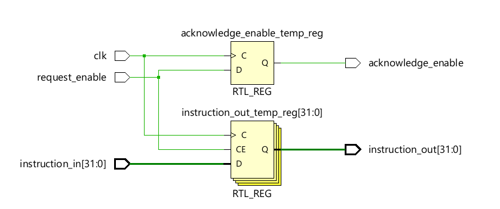
    <p><em>Figure 4. Instruction Register'a Ait Lojik Devre Tasarımı</em></p>
</div>

<p align="justify">Instruction Register'dan çıkan 32 bitlik binary komut Instruction Decoder'da decode edilmektedir. 32 bit uzunluktaki binary komut temel lojik kapılar özellikle de AND ve NOT kapıları ile decode edilmiştir. RISC-V'de gelen komutun hangi buyruk türüne ait olduğu LSB'den başlayan ilk 7 bit belirlemektedir. Hangi buyruk türüne ait olduğu belirlenen komutun hangi işlemi (toplama, çarpma, veri yükleme vb..) yaptığı ise funct3 ve funct7 kısımları belirlemektedir. 32 bitlik bu komutun içerisinde aynı zamanda Register File'da hangi adresteki registerlara ait verilerin okunacağı (rs1 ve rs2) ve hangi adresteki registera (rd) yazılacağı d yine bu 32 bitlik komutun içerisinde yer almaktadır. Instruction Decoder, her bir komut içi birer tane olmak üzere toplamda 17 farklı enable sinyali üretmektedir. Bu üretilen sinyallerden hangisi lojik = 1 ise ALU'da o işlemin yapılacağı bölüm çalışmaktadır. Instruction Decoder kendi üzerine düşen işi yaptıktan sonra Control Unit'e acknowledge sinyali gönderir ve FSM içerisindeki bir sonraki duruma geçiş yapılır. Bu sayede 1 tane request ve 1 tane acknowledge sinyali ile sadece 2 cycle da Decode işlemi bitmiştir. Figure 5'de Instruction Decoder'ın lojik tasarımı gösterilmiştir.</p>

<div align="center">
    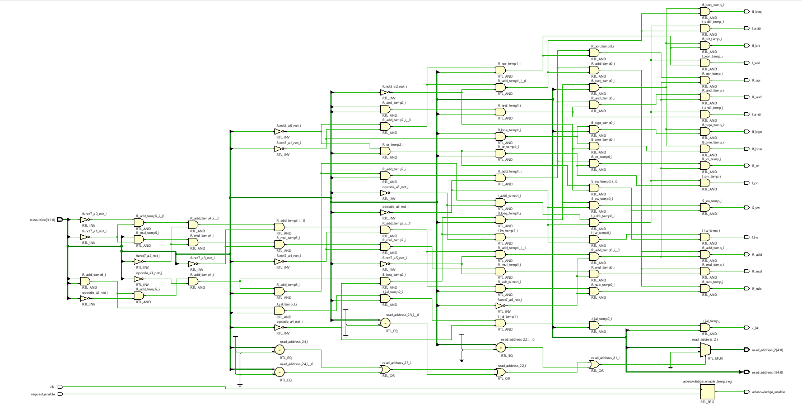
    <p><em>Figure 5. Instruction Decoder'a Ait Lojik Devre Tasarımı</em></p>
</div>

<p align="justify">ALU; Instruction Decoder'ın decode ettiği, 5 bit uzunlukt olan ve Register File'da hangi adresteki register'ların okunacağını Instruction Decoder ile Register File arasındaki bağlantı ile sağlamıştır. Bu sayede Register File'dan gelen 32 bitlik veriler (rs1 ve rs2) de ALU ile bağlantı kurabilmektedir. ALU'ya aynı zamanda 17 farklı komuta ait enable sinyali de gelemktedir. ALU, kendisine gelen bu enable sinyallerinden sadece lojik = 1 olan sinyale ait işlemleri yapmaktadır. ALU hem Register File'a hem de Data Memory'e 32 bitlik veri yazabilir. ALU kendi üzerine düşen işi yaptıktan sonra Control Unit'e acknowledge sinyali gönderir ve FSM içerisindeki bir sonraki duruma geçiş yapılır. Bu sayede 1 tane request ve 1 tane acknowledge sinyali ile sadece 2 cycle da Execute işlemi bitmiştir. Burada dikket edilmesi gereken kısım, ALU'da işlemlerin yürütülme kısmının tamamen asenkron olması ancak acknowledge sinyalinin gönderilmesinin senkron olmasıdır. Figure 6'de ALU'nun lojik tasarımı gösterilmiştir.</p>

<div align="center">
    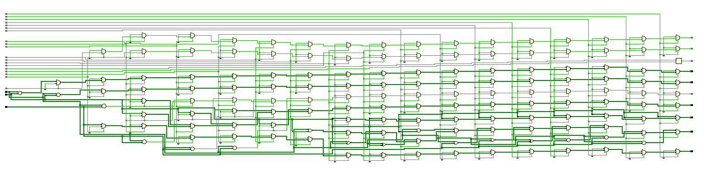
    <p><em>Figure 6. ALU'ya Ait Lojik Devre Tasarımı</em></p>
</div>

<p align="justify">Register File, FPGA'de Distributed RAM kullanılarak tasarlanmış olup yazma işlemi saat sinyalinin yükselen kenarında olup senkron çalışmaktadır. Ancak okuma işlemi tamamen asenkron çalışmakta olup saat sinyali ile aktif olmaz. Register File, Instruction Decoder'dan 2 farklı 5 bitlik uzunlukta adres verisi almakta olup ALU ile çift yönlü etkileşimi bulunmaktadır. Figure 7'de Register File'ın lojik tasarımı gösterilmiştir.</p>

<div align="center">
    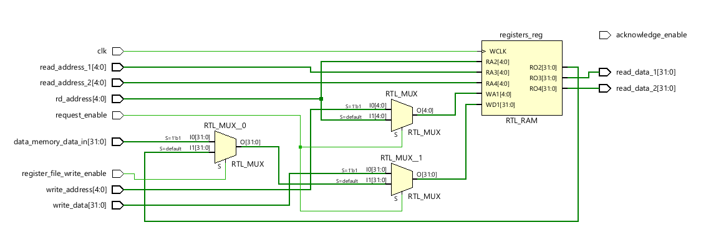
    <p><em>Figure 7. Register File'a Ait Lojik Devre Tasarımı</em></p>
</div>

<p align="justify">Data Memory, Distributed RAM ile tasarlanmıştır. Data Memory'e ALU üzerinden saat sinyaline senkron olacak şekilde yazma ve Register File'a veri yüklemek için asenkron okuma işlemi yapılabilmektedir. Data Memory kendi üzerine düşen işi yaptıktan sonra Control Unit'e acknowledge sinyali gönderir ve FSM içerisindeki bir sonraki duruma geçiş yapılır. Bu sayede 1 tane request ve 1 tane acknowledge sinyali ile ALU üzerinden Data Memory'e veri yazma işlemi olan Memory Write, sadece 2 cycle da bitmiştir. Bir diğer işlem olan Write Back ise Data Memeory'deki verinin Register File'a geri gönderilmesi demek olup Memoey Write veya Write Back durumları bittikten sonra bir sonrakin komutun Fetch işlemine geçiş yapılamaktadır. Böylece 1 komuutn Instruction Cycle döngüsü bitmiştir ve diğer komutun Instruction Cycle döngüsüne geçiş yapılmıştır. Figure 8'de Data Memory'nin lojik tasarımı gösterilmiştir.</p>

<div align="center">
    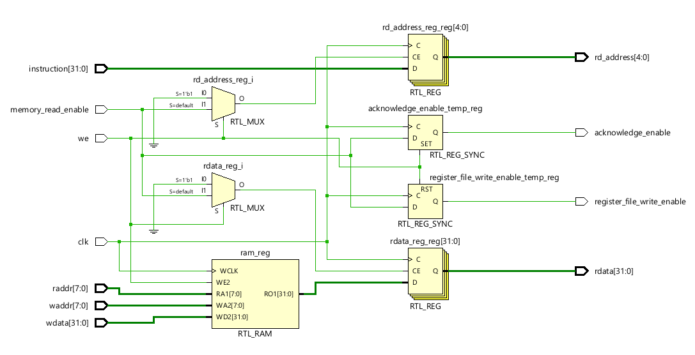
    <p><em>Figure 8. Data Memory'e Ait Lojik Devre Tasarımı</em></p>
</div>

<h3 align="left">4. RISC-V Assembly Kodlarını Çalıştırma</h3>

<p align="justify">Tasarımı yapılan CPU; bellekten veri çekme, belleğe veri yazma, aritmetik işlemler, lojik işlemler, koşullu ve koşulsuz dallanma gibi işlemleri yerine getirebilmesi gerekmektedir. Bu tüm işlemleri barındıran RISC-V assembly kodu ve muadili olan C diline göre yazılmış kod aşağıda gösterilmiştir.</p>

```asm
li t0, 0x00000004
li t1, 12
sw t1, 0(t0)
li t2, 18
sw t2, 4(t0)
lw t3, 0(t0)
lw t4, 4(t0)
blt, t1, t2, dallanma_1
add t5, t3, t4
sw t5, 8(t0)
jal zero, 12
dallanma_1:
mul t5, t3, t4
sw t5, 8(t0)
sub t3, t5, t2
sw t3, 12(t0)
bne t3, t2, dallanma_2
xor, t1, t2, t3
sw t1, 16(t0)
jal zero, 12
dallanma_2:
add t4, t3, t2
sw t4, 16(t0)
mul t4, t4, t2
sw t4, 20(t0)
```

```c
#include <stdint.h>

void main(){

    volatile int32_t *ptr = (volatile int32_t *)0x00000004;

    int32_t t1 = 12;
    int32_t t2 = 18;
    int32_t t3, t4, t5;

    ptr[0] = t1;
    ptr[1] = t2;

    t3 = ptr[0];
    t4 = ptr[1];

    if (t1 >= t2){
        t5 = t3 + t4;
        ptr[2] = t5;
    }
    else{
        t5 = t3 * t4;
        ptr[2] = t5;
    }

    t3 = t5 - t2;
    ptr[3] = t3;

    if (t3 == t2){
        t1 = t2 ^ t3;
        ptr[4] = t1;
    }
    else{
        t4 = t3 + t2;
        ptr[4] = t4;
    }

    t4 = t4 * t2;
    ptr[5] = t4;

}
```

<h3 align="left">5. Simülasyon Testleri</h3>

<p align="justify">Tüm simülasyonlar Vivado üzerinden yapılmıştır. Bu sayede hangi sat sinyalinin yükselen kenarında hangi register'a veri yazzıldığı veya hangi sinyalin lojik = 1 olduğu görülebilmiştir. Figure 9'da Control Unit tarafından üretilen request ve Control Unit tarafından FSM'nin anlık durumuna karar vermesi için kullanılan acknowledge sinyallerinin zaman diyagramı gösterilmiştir. Her bir request sinyalinin ardından gelen yükselen kenarda o request sinyaline ait acknowledge sinyali lojik = 1 olmaktadır. Bu Control Unit'de tasarlanan FSM'nin temel çalışma mekanizmasıdır. Figure 10'da her bir komut için Instruction Decoder'ın ürettiği ve ALU'nun hangi komuta ait işlemi yapacağını gösteren enable sinyallerinin zaman diyagramı gösterilmiştir. Figure 11'de Register File, ALU ve Data Memory arasındaki veri transferinin zaman diyagramı gösterilmiştir. Figure 12'de yukarıda gösterilen ve çalışması hedeflenilen assebmly kodunun son komutuna olan (sw t4, 20(t0)) komutuna ait zaman diyagramı gösterilmiştir. Eğerki yapılan CPU tasarımı doğru ise tüm işlemler sonucunda S_sw komutu lojik = 1 olmalı, Data Memery'e ait 0x18 adresteki hücreye 32 bitlik 0x00000f30 verisi yazılmalıdır. Bu simülasyona göre de bu durumun doğru bir şekilde yapıldığı görülmüştür.</p>

<div align="center">
    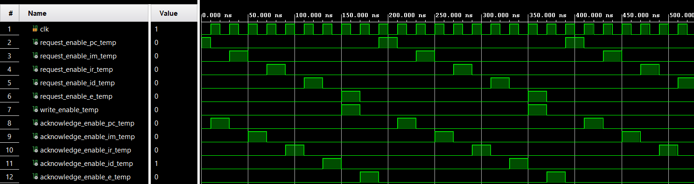
    <p><em>Figure 9. Control Unit'in Kullandığı Request ve Acknowledge Sinyallerine Ait Zaman Diyagramının Gösterimi</em></p>
    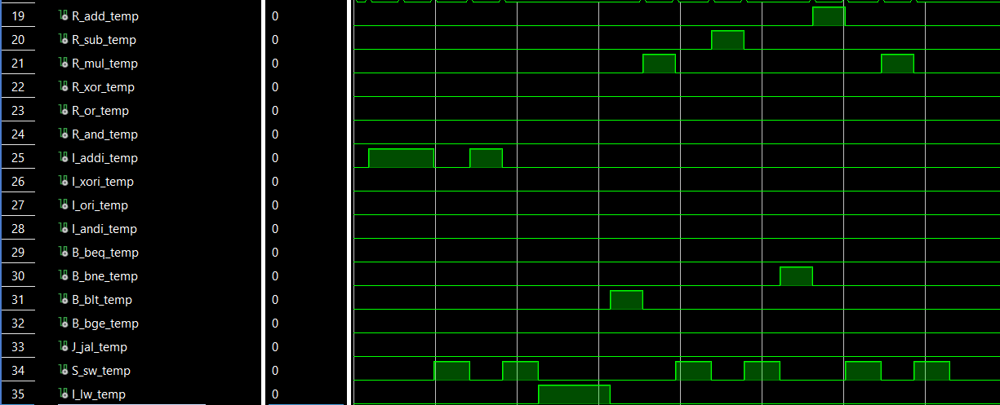
    <p><em>Figure 10. Her Bir Komutta Instruction Decoder Tarafından  Decode Edilen Sinyallere Ait Zaman Diyagramının Gösterimi</em></p>
    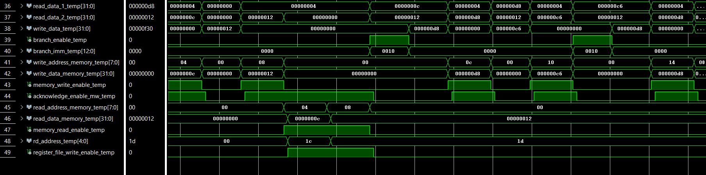
    <p><em>Figure 11. Register File, ALU ve Data Memory Arasındaki Veri Transferlerine Ait Zaman Diyagramının Gösterimi</em></p>
    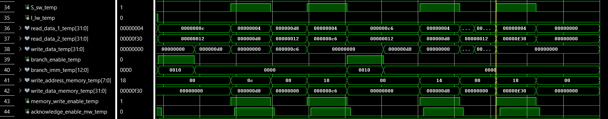
    <p><em>Figure 12. RISC-V Assembly Koduna Ait Son Komuta Ait Zaman Diyagramının Gösterimi</em></p>
</div>

<h3 align="left">6. Statik Zaman Analizi Testleri</h3>

<p align="justify">Simülasyon testleri tasarımı yapılan lojik devrelerin istenilen saat frekansında çalaışıp çalaışmayacağını göstermektedir. Statik Zaman Analizi kapsamında Flip-Flop'lar da metastability durumunun tespiti için kullanılan iki farklı metrik bulunmaktadır: Setup Time ve Hold Time. Herhangi bir metastability durumun oluşmaması için verinin bir sonraki saat sinyalinden daha önce bir süre de FLip-Flop'un kapısına gelmesi gerekir (Setup Time). Herhangi bir metastability durumunun oluşmaması için verinin saat sinyali Flip-Flop'un kapısına geldikten en az ne kadar süre daha Flip-FLop'un giriş bacağında sabit kalması gerekir (Hold Time). Figure 13'de Statik Zaman Analizi'ne ait testlerin başarıyla geçildiği görülmektedir. Setup Time için örnek vermek gerekirse tasarımdaki en yavaş veri yolu bile gereken süreden yaklaşık 5 ns daha erken Flip-FLop'un kapısına gelmiştir.</p>

<div align="center">
    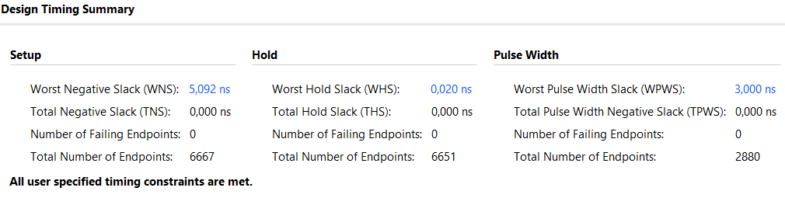
    <p><em>Figure 13. Statik Zaman Analizi Test Sonuçları</em></p>
</div>

<h3 align="left">7. Tasarımın FPGA'ya Aktarılması (Implementation)</h3>

<p align="justify">Tasarımı yapılan CPU'nun FPGA üzerindeki implementasyonu Figure 14 ve Figure 15'de gösterilmiştir.</p>

<div align="center">
    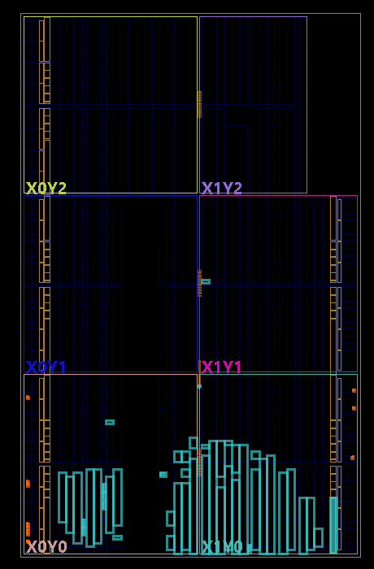
    <p><em>Figure 14. FPGA'de Tasarımın Gösterimi (Place and Route)</em></p>
    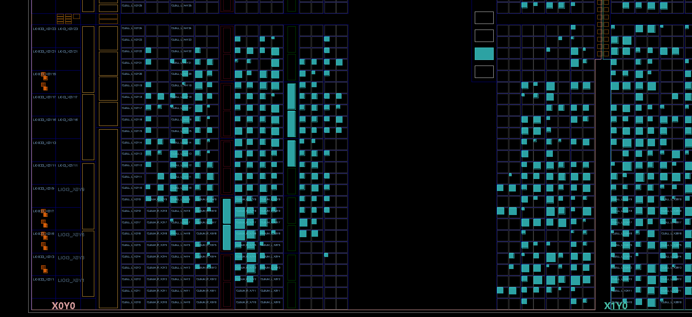
    <p><em>>Figure 15. FPGA'de Tasarımın Gösterimi (Place and Route)</em></p>
</div>
